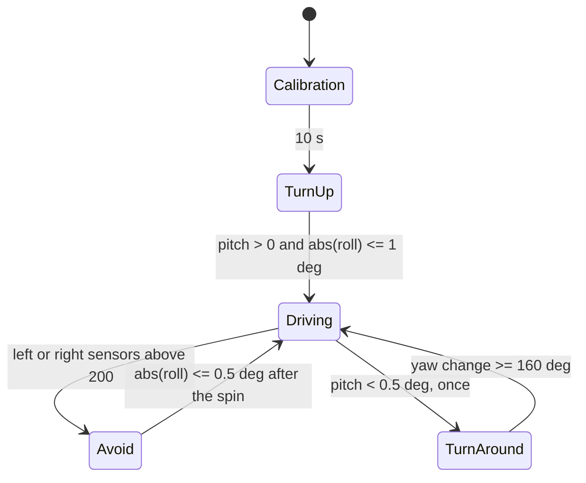

# CSE 522: Real-Time Embedded Robotics

Lingua Franca programs that drive a [Pololu 3pi+ 2040](https://www.pololu.com/product/5001) on an RP2040. The robot climbs a ramp and comes back down, follows a dark line to its end, and runs the smaller navigation and sensing programs that those two behaviors are built from.

This is coursework from Arizona State University, CSE 522: Real-Time Embedded Systems, Fall 2025. Ramp climbing and line following were team coursework. Hunter Flechsig ([HunterFlechsig](https://github.com/HunterFlechsig), hunterflechsig@gmail.com).

Hardware reference: [Pololu 3pi+ 2040 user's guide](https://www.pololu.com/docs/0J86).

## What the robot does

**Ramp.** [`src/HillClimb.lf`](src/HillClimb.lf) calibrates the downward reflectance sensors for 10 seconds, then rotates in place until the accelerometer says the nose is uphill (`pitch > 0`) and the robot is nearly level (`|roll| ≤ 1°`). It then drives at 0.2 m/s. A dark reading above 200 on the left sensor pair or the right sensor pair reverses both wheels at 0.1 m/s for 500 ms and spins until `|roll| ≤ 0.5°`. The first time pitch falls below 0.5°, the robot treats that as the flat top, spins until integrated yaw has changed by 160°, and drives again. Roll steering swaps wheels after that turn, so the same correction points downhill. The `STOP` mode is in the file and is never selected; the descent is the second pass through `DRIVING`.

Before the turnaround, roll below −0.5° slows the right wheel. After it, the same roll slows the left wheel. The command is `0.2 - |roll| * 0.01`:

```c
if (tilt.roll->value < -0.5) {
  lf_set(motors.right_speed, (0.2 - fabsf(tilt.roll->value) * 0.01));
}
```

Wheel speed on the ramp and on the line is the supplied PI controller in [`src/lib/MotorsWithFeedback.lf`](src/lib/MotorsWithFeedback.lf) (default gains 0.5 and 0.25), fed by the encoders. The square, bump, and edge-avoid programs command open-loop motor power instead.



Two earlier ramp programs sit beside that controller. [`src/HillEdgeDetect.lf`](src/HillEdgeDetect.lf) labels the five sensors LEFT, MIDDLE, or RIGHT when a calibrated reading exceeds 200. More than one label can be true. [`src/HillEdgeAvoid.lf`](src/HillEdgeAvoid.lf) drives at power 0.2 and, on a dark left or right pair, reverses for 200 ms and spins for 200 ms.

**Line.** [`src/LineFollow.lf`](src/LineFollow.lf) calibrates for 6 seconds, then drives straight at 0.1 m/s. The leftmost sensor above 200 pivots by driving only the right wheel at 0.2 m/s. The rightmost sensor drives only the left wheel. Straight travel resumes when that same outer sensor drops below 200. All five sensors below 200 stops the robot and shows `END OF LINE`. The middle three sensors are only part of that end-of-line check. This program does not read the gyroscope.

```c
if (line.reflect->value[0] > 200) {
  self->avoid_direction = 1;
  lf_set_mode(AVOID);          /* right wheel 0.2 m/s, left wheel 0 */
}
```

**Supporting programs.**

| Program | Behavior |
| --- | --- |
| [`src/SquareDrive.lf`](src/SquareDrive.lf) | Open-loop square. A side ends when either wheel reaches 50 cm. A corner ends when yaw changes by 80°. Encoders every 100 ms, gyro every 200 ms. |
| [`src/BumpAvoid.lf`](src/BumpAvoid.lf) | Same square. A bump on either side, sampled every 5 ms, reverses both wheels for 750 ms and then turns. |
| [`src/EncoderDistance.lf`](src/EncoderDistance.lf) | Prints wheel distance in centimeters once a second. |
| [`src/DriveToggle.lf`](src/DriveToggle.lf) | Alternates power 0.5 and stopped every 2 seconds. |
| [`src/TiltDisplay.lf`](src/TiltDisplay.lf) | Prints pitch and roll every 250 ms. The robot does not drive. |

[`src/lib/Tilt.lf`](src/lib/Tilt.lf) turns the accelerometer vector into degrees:

```c
float pitch_rad = asin(x->value / sqrt(x*x + y*y + z*z));
float roll_rad = atan2(y->value, z->value);
```

[`src/lib/AngleToDistance.lf`](src/lib/AngleToDistance.lf) treats one encoder count as one degree (`COUNTS_PER_REV` is 360 in the supplied speed controller) and converts with a 3.175 cm wheel diameter: `(degrees / 360) * diameter * π`.

The LED programs ([`TimedBlink.lf`](src/TimedBlink.lf), [`LoggedBlink.lf`](src/LoggedBlink.lf), [`ReactorBlink.lf`](src/ReactorBlink.lf)) toggle the onboard LED on a 250 ms cadence. [`src/Blink.lf`](src/Blink.lf) is the template blink.

## How a program is put together

Each robot program is one Lingua Franca file with a `Robot` reactor and a set of modes. A timer reaction samples sensors. Mode reactions command motors and call `lf_set_mode`.

On the ramp, one 50 ms timer triggers the line sensors, the accelerometer, and the encoders together. The line follower uses the same period for the line sensors and the encoders. That period matches the note on the supplied PI controller, which was tuned for samples of about 50 ms. The square uses 100 ms encoder samples and 200 ms gyro samples. Bump sensing is 5 ms. Tilt display is 250 ms. Delays are logical actions or one-shot timers: 200 ms, 500 ms, and 750 ms.

The programs are `single-threaded: true`. The supplied IMU reactors share one device and say they rely on an unthreaded runtime.

Sensors actually read by these programs:

- LSM6DSO accelerometer and gyroscope over I2C. Pitch and roll come from the accelerometer. Yaw for the square, the bump turn, and the ramp turnaround comes from the supplied `GyroAngle` reactor, which integrates gyro rate with a trapezoidal sum and is baselined on the first sample of each turn.
- Five downward reflectance sensors. Higher calibrated readings mean less reflected light. The library scales them to about 0–1024. The line sensors and the bump sensors cannot be used together.
- Quadrature encoders, counted in the supplied library and treated as degrees.

The magnetometer on the board is unused. There is no sensor fusion in these files.

## Concepts in the code

- **Modes.** Calibration, drive, avoid, and turn are separate modes with their own reactions. The ramp turnaround creates a new `GyroAngle` on entry, so the yaw baseline starts over.
- **Timed sampling.** Sensor triggers and motor updates are timer reactions. The 50 ms ramp and line loop is the same order as the PI sample period the speed controller was written for.
- **Dead reckoning.** Encoder distance subtracts a baseline count, converts degrees to centimeters, and stops a square side at 50 cm.
- **Threshold turns.** Square and bump turns stop at 80° of integrated yaw. The ramp turnaround stops at 160°.
- **Tilt.** Pitch distinguishes the slope from the flat top. Roll steers, with a ±0.5° deadband on the ramp and a ±1° window while turning to face uphill. Inside the driving deadband the last speed command is left in place.
- **Two policies on one sensor.** Edge avoidance treats a dark outer pair as a boundary and spins away. Line following treats a dark outer sensor as the line and pivots toward it, and treats five light readings as the end.
- **Open loop and closed loop.** Square, bump, drive-toggle, and edge avoidance set motor power. Ramp climbing and line following set meters per second and let the supplied PI controller track it from the encoders.

The constants above are the ones in the source: 200 counts, 0.5°, 1°, 50 cm, 80°, and 160°.

## Repository

```text
src/HillClimb.lf            Ramp: calibrate, face uphill, drive, avoid edges, turn, descend
src/HillEdgeDetect.lf       Label dark sensors LEFT / MIDDLE / RIGHT
src/HillEdgeAvoid.lf        Open-loop drive and spin away from a dark edge
src/LineFollow.lf           Pivot on the outer reflectance sensors until the line ends
src/SquareDrive.lf          50 cm sides, 80 degree corners
src/BumpAvoid.lf            Square plus reverse-and-turn on a bump
src/EncoderDistance.lf      Encoder counts to centimeters
src/DriveToggle.lf          Drive and stop on a 2 second timer
src/TiltDisplay.lf          Pitch and roll on the display
src/lib/Tilt.lf             Accelerometer vector to pitch and roll
src/lib/AngleToDistance.lf  Encoder degrees to centimeters
src/lib/                    Supplied reactors: motors, PI, IMU, line, bump, display
robot-lib/                  Pololu 3pi+ 2040 C library used by those reactors
test/                       Pico emulator (rp2040js). It does not model the robot.
```

`src/lib/` also contains supplied reactors for motors, encoders, the IMU, the line sensors, the bump sensors, and the OLED. Display programs for those sensors (`AccelerometerDisplay.lf`, `GyroDisplay.lf`, `LineDisplay.lf`, and the others) are from the lab template.

## Building and running

The Lingua Franca compiler is installed separately. It is not a package in [`shell.nix`](shell.nix). Java 17 is required. Setup for the course is documented at [Getting started](https://www.lf-lang.org/embedded-lab/GettingStarted.html) and [Prerequisites](https://www.lf-lang.org/embedded-lab/Prerequisites.html).

```bash
curl -Ls https://install.lf-lang.org | bash -s cli
nix develop
lfc src/HillClimb.lf          # writes bin/HillClimb.elf
```

`nix develop` runs the hook in `shell.nix`: it initializes the Pico SDK submodule and the SDK's own submodules, copies `robot-lib/pololu_3pi_2040_robot.h` into the SDK board headers, and runs `npm install` in `test/`. Without Nix, the [non-Nix setup](https://www.lf-lang.org/embedded-lab/NonNix.html) uses `cmake`, `make`, `gcc`, `gcc-arm-none-eabi`, and `libnewlib-arm-none-eabi`.

Flash in BOOTSEL (hold B, press RESET, release B):

```bash
picotool load -x bin/HillClimb.elf
```

On Linux, picotool needs the [Raspberry Pi udev rule](https://raw.githubusercontent.com/raspberrypi/picotool/master/udev/60-picotool.rules). The motors run from the batteries. USB power alone does not run them.

`cd test && npm start` runs the Wokwi-based Pico emulator on hex files placed in `test/`. A test that does not finish within 10 seconds is reported as failing. The emulator models a Pico, so it does not stand in for the robot programs.

## Course and attribution

Arizona State University, CSE 522: Real-Time Embedded Systems, Fall 2025, using the [Lingua Franca Embedded Lab](https://www.lf-lang.org/embedded-lab/). The course is listed with that lab on the [LF institutions page](https://www.lf-lang.org/embedded-lab/Institutions.html).

This repository started from [lf-3pi-template](https://github.com/lf-lang/lf-3pi-template). Left in place, and not reauthored:

- Lingua Franca and the LF Embedded Lab reactors by Abhi Gundrala, Edward A. Lee, and the lab authors (the [Berkeley EECS 149 / 249A](https://www.lf-lang.org/embedded-lab/) lineage, including work associated with Hokeun Kim's lab materials).
- The [Raspberry Pi Pico SDK](https://github.com/raspberrypi/pico-sdk), as a submodule.
- The [Pololu 3pi+ 2040 robot library](https://github.com/pololu/pololu-3pi-2040-robot) by David Grayson, under `robot-lib/`, plus the SH1106 display code by Adam Green. See [`LICENSE.txt`](LICENSE.txt).
- The Pico emulator under `test/`, based on [Wokwi](https://wokwi.com) and [rp2040js](https://github.com/wokwi/rp2040js).

The ramp, line, square, bump, distance, drive, tilt, and LED programs under `src/` listed above, plus `Tilt.lf`, `AngleToDistance.lf`, and `LED.lf`, are the coursework. The PI speed loop those programs call is the supplied `MotorsWithFeedback` reactor.
